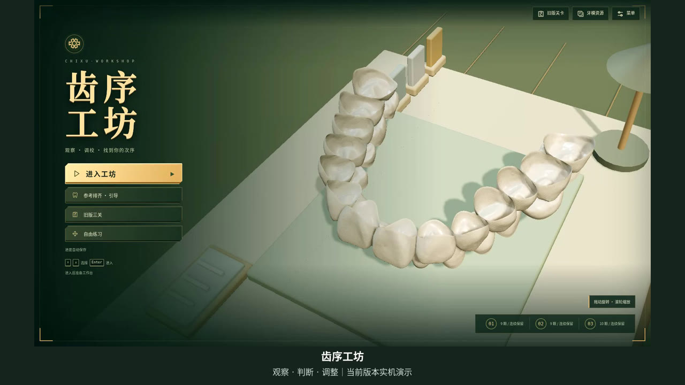

# 齿序工坊 · 当前版本实机演示

[下载演示视频（MP4，1 分 52 秒，1080P，约 4.5 MiB）](https://raw.githubusercontent.com/Ssir-creator/zhengji/chi-xu-workshop-dev/chi-xu-workshop/docs/videos/chi-xu-workshop-current-20261026.mp4)

录制日期：2026 年 10 月 26 日。录制代码版本：`fef8a62`。格式：H.264 / 1920×1080 / 25fps，中文字幕，无配音。

内容包括三段式界面、视角切换、原始与参考对比、观察作答、拖动平移与旋转、取消、核对反馈、撤销、开放试验、精细调整、方案保存与只读回放。视频实际完成一颗牙的操作闭环，没有将局部完成呈现为完整病例通关。

游戏画面来自实际浏览器操作，未预置过关存档或直接写入目标位姿。等待过程经过剪辑，加速片段在字幕中标注；字幕位于游戏画面外。已经检查画面与字幕，并通过整段解码和格式检查。文件 SHA-256 与检查结果见 [verification.json](verification.json)。

可随视频发送给老师的介绍：

> 这是《齿序工坊》目前版本的实机演示，展示“观察—判断—调整—复核”的交互流程，以及过程试验、撤销和操作回放功能。

## 旧版演示（2026 年 10 月 25 日）

[下载旧版演示（MP4，1 分 48 秒，1080P，约 7.3 MiB）](https://raw.githubusercontent.com/Ssir-creator/zhengji/chi-xu-workshop-dev/chi-xu-workshop/docs/videos/chi-xu-workshop-legacy-20261025.mp4)

录制版本：`42187c0`。内容为旧版参考排齐引导、三批连续完成、原始与参考对比和自由练习。它不包含后续加入的观察挑战与三段式界面。此文件与原先提供的 10 月 25 日视频内容一致，仅补充可访问的下载入口。

SHA-256：`7a6f6c546d274bb1dc30d17533ee0ec74950805efd04f399681016af4a13f400`。
